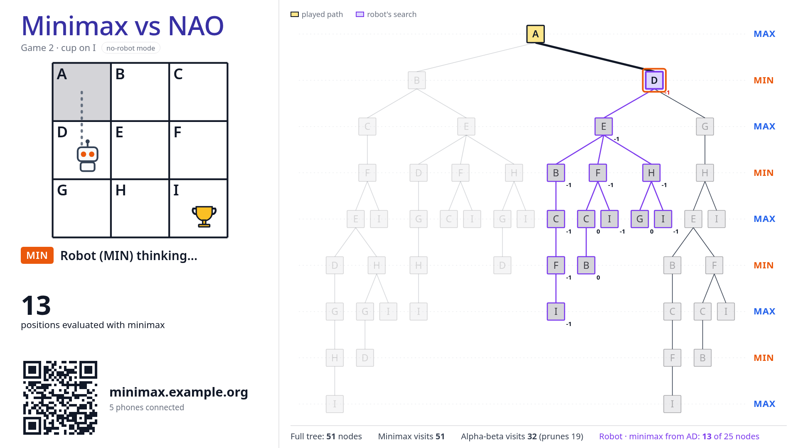
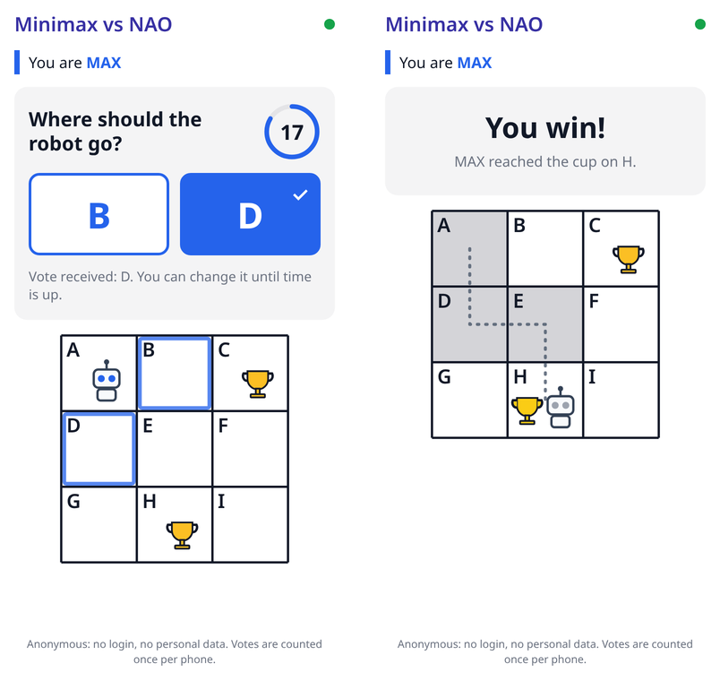
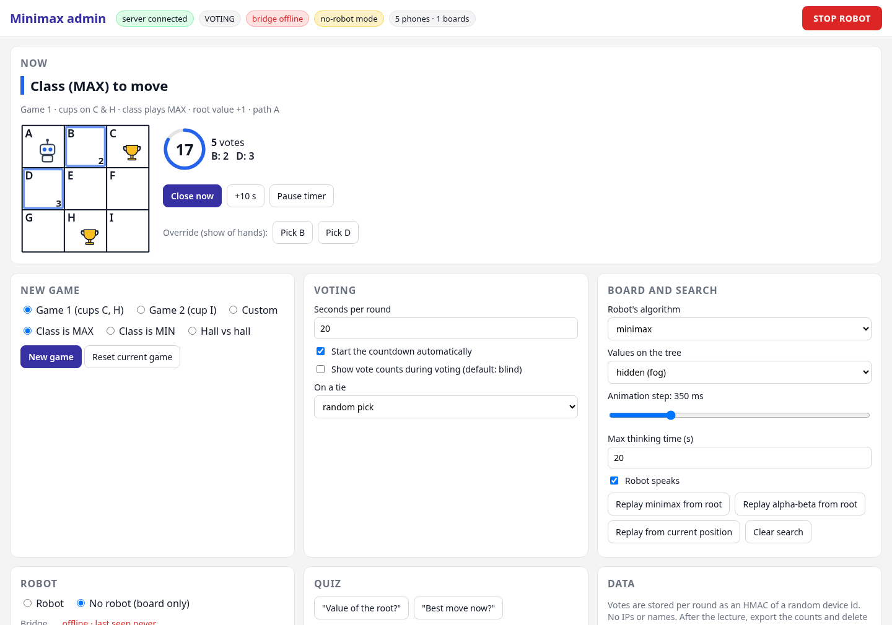
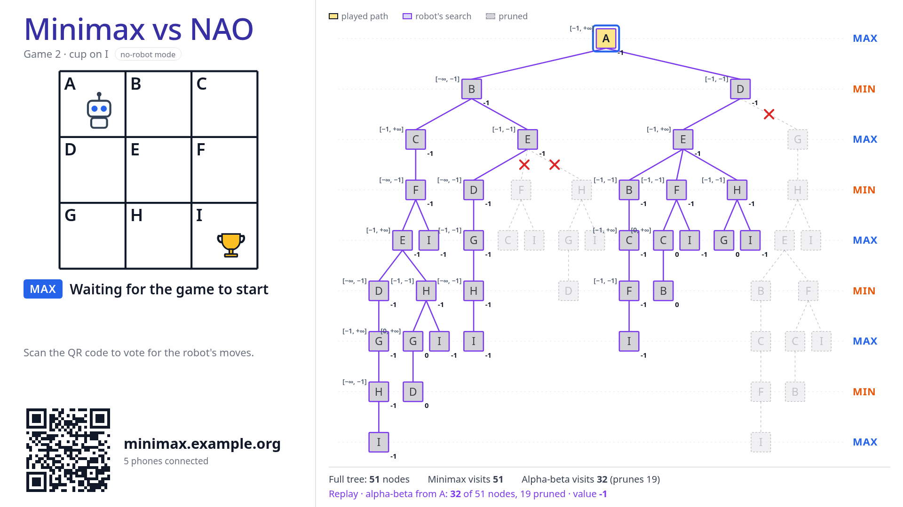

# Robot minimax demo

A live classroom demo of adversarial search with a NAO robot. Students vote on their phones for the robot's next move, the robot plays the other side using minimax, and the projector shows the game tree while the robot searches it.

Built for the *Adversarial Search and Games* lecture of an introductory AI course, for a hall of about 100 students.



## The game

The robot stands on a taped 3×3 grid. Two players take turns moving it one cell horizontally or vertically. The robot may never return to a cell it has visited. The first player to move the robot onto a cup wins, and if no legal move is left the game is a draw.

```
A B C
D E F
G H I
```

The robot starts on A, MAX moves first, and moves are tried in alphabetical order. Two setups are built in:

| Game | Cups | Value of the root | What happens with optimal play |
|---|---|---|---|
| 1 | C and H | +1 | MAX wins. Moving to B loses at once, because MIN steps onto C. |
| 2 | I | −1 | MIN always wins. The tree is deeper and contains draws. |

There is also a custom setup, where you choose the start cell and the cups yourself.

## How a game goes

The robot is the shared game piece: it walks on every turn, but it only *decides* on its own turns.

1. **The class moves.** The class plays MAX by default. Phones show only the legal moves. Students vote within the countdown, and the majority decides. The robot then says "You chose D. Let me walk there." and walks there.
2. **The robot moves.** The robot plays MIN by default and searches the tree from the current position. On the board, nodes light up in the order the search visits them and values propagate up the tree. The robot then announces its move ("I evaluated 13 positions. I go to E.") and walks.
3. This repeats until someone reaches a cup or no legal move is left.

The robot's eye LEDs show the colour of the player whose turn it is (blue for MAX, orange for MIN), matching the colours on the board.

| Phone | Admin panel |
|---|---|
|  |  |

The board can also replay a full search from the root, with minimax or with alpha-beta. In alpha-beta mode it shows the `[α, β]` interval on each node and crosses out the pruned branches:



## Features

- **Board** (`/board`, for the projector):
  - grid mirror, game tree, countdown, QR code to join;
  - animated minimax or alpha-beta search;
  - node counters comparing minimax with alpha-beta;
  - a fog setting that hides values until you reveal them.
- **Phone** (`/`):
  - no login, large buttons for the legal moves only, and a ✓ once the server has the vote;
  - survives the screen locking and network changes;
  - the page bundle is about 38 KB gzipped.
- **Admin** (`/admin`, for the TA): every automatic step can be overridden.
  - voting: close, extend or pause a round, pick the move;
  - robot: skip the thinking pause, override its move, nudge it, resync its position;
  - STOP, and switch to board-only mode;
  - quiz questions, data export.
- **Game modes:** the class plays MAX or MIN against the robot, or *Hall vs Hall*, where the left half of the room plays MAX and the right half plays MIN.
- **Robustness:**
  - The server holds the game state. Every update is a full snapshot, so a phone that reconnects is immediately in sync.
  - Votes count once per device.
  - The game survives a server restart (SQLite).
  - If the robot fails, the game continues on the board.
- **Privacy:** votes are stored as an HMAC of a random device id. No IP addresses or names are stored, and the raw votes can be deleted after the lecture.

## Architecture

```
 Student phones ──┐
 Projector PC ────┤  HTTPS / WebSocket (Socket.IO)
                  ▼
        Server (Docker): FastAPI + Socket.IO + static web + SQLite
                  ▲
                  │  HTTPS long-polling, outbound only, bearer token
 TA laptop:  bridge.py      (Python 3)    the only part that talks to the server
                  │  ZMQ on 127.0.0.1
             nao_driver.py  (Python 2.7, NAOqi SDK)  ── Wi-Fi ──►  NAO robot
```

The robot network never has to be reachable from the internet. The NAOqi SDK needs Python 2.7, so that code is kept small and has no network access beyond the robot and localhost. A `cmd_id` per command makes sure a retried command never makes the robot walk twice. A `stop` uses a separate channel, so it can interrupt a walk that is running.

```
server/   game engine, minimax/alpha-beta with trace, game flow, SQLite, Socket.IO, bridge API
web/      Vite + Svelte 5: phone, board and admin pages
bridge/   bridge.py (Python 3), nao_driver.py + robot.py (Python 2.7, NAOqi), fake_driver.py
tools/    loadtest.py (simulated phones)
deploy/   docker-compose.yml for a VPS behind Traefik
```

## Quick start

With Docker:

```bash
docker run -p 8000:8000 -e ADMIN_TOKEN=dev -e BRIDGE_TOKEN=dev -e DEVICE_HASH_SECRET=dev \
  -v minimax-data:/data ghcr.io/stanmar-bit/robot-minimax:latest
```

Then open these pages:

- <http://localhost:8000/board> for the projector;
- <http://localhost:8000/admin#token=dev> for the TA; the browser keeps the token and removes it from the URL;
- <http://localhost:8000/> for the phone view.

The server starts in board-only mode with game 1 in the lobby. Click **Start game** in the admin panel.

From source (Python 3.12 with [uv](https://docs.astral.sh/uv/), Node 22+):

```bash
cd server && uv sync
cd ../web && npm ci && npm run build
cd ../server
ADMIN_TOKEN=dev BRIDGE_TOKEN=dev DEVICE_HASH_SECRET=dev .venv/bin/uvicorn app.main:app --port 8000
```

For frontend work with hot reload, run `npm run dev` in `web/` (port 5173, proxies to the server). If the project lives in a synced folder such as OneDrive or Dropbox, `web/install-deps.sh` installs `node_modules` in `~/.cache` and symlinks it.

## Robot side (TA laptop)

The laptop needs:

- the NAOqi Python SDK 2.8 (`pynaoqi-python2.7-…`), which is not included in this repository;
- a Python 2.7 environment with `pyzmq`;
- Python 3 with `requests` and `pyzmq`.

```bash
# terminal 1: driver (Python 2.7); talks only to the robot and to localhost
conda run --no-capture-output -n nao python bridge/nao_driver.py --nao-ip 192.168.50.10
# terminal 2: bridge (Python 3); outbound HTTPS to the server
SERVER_URL=https://minimax.example.org BRIDGE_TOKEN=... python3 bridge/bridge.py
```

The admin panel then shows **bridge online** and the battery level; switch to **Robot** mode there. To try the chain without a robot, run `python3 bridge/fake_driver.py` or `nao_driver.py --sim` instead of the driver.

| Driver option | Meaning |
|---|---|
| `--walk strafe` (default) / `turn` | Always face the audience and step sideways, or turn, walk forward and turn back |
| `--cell-size 0.5` | grid cell size in metres |
| `--row-sign -1`, `--col-sign -1` | for a mirrored grid (default: row A‑B‑C furthest from the audience, A on the audience's left) |
| `--odometry-log drift.csv` | expected vs. measured displacement per move, for the drift test |
| `--max-step-x`, `--step-frequency`, `--volume` | gait and speaker tuning |
| `--sdk PATH` | NAOqi SDK location (default `$NAOQI_SDK`, then `~/nao/pynaoqi-…`) |
| `--ssh-user nao`, `--ssh-password nao` | SSH login on the robot, used to fetch its speech for the hall (password also from `$NAO_SSH_PASSWORD`) |

**Robot voice in the hall.** With *Also play the robot's voice on the board* on (admin settings, on by default), the bridge first renders every line on the robot with `ALTextToSpeech.sayToFile`, fetches the WAV over SSH, and uploads it as MP3 (when `ffmpeg` is installed). The board plays it while the robot says the same line, so the lecture-hall speakers carry the NAO's own voice. This adds about half a second before each new line; repeated lines are cached by the bridge. Click **Enable robot voice** on the board once after opening it, since browsers block sound until the page has been clicked.

The driver connects with a `qi.Session` client rather than `ALProxy`. An `ALProxy` starts a local NAOqi broker that listens on every network interface of the laptop; a `qi.Session` client opens no listening port.

## Deployment

Run one container with one worker: the game state lives in memory, so don't scale it horizontally. `deploy/docker-compose.yml` runs it behind an existing Traefik, with Let's Encrypt and basic auth on `/admin` in addition to the admin token:

```bash
cd deploy && cp .env.example .env   # host, cert resolver, tokens, htpasswd
docker compose up -d
```

The same image also works as an offline fallback on the TA laptop. Run it there and point the bridge at `http://localhost:8000`.

## During the lecture

| Situation | What to do in the admin panel |
|---|---|
| Robot or bridge fails | Robot → **No robot (board only)**. A walk that is stuck completes on the board. |
| A walk failed or the robot drifted | **Robot is at X**, **Retry move**, or the nudge buttons |
| Phones can't vote | Count a show of hands, then **Pick X** |
| The robot must stop immediately | **STOP ROBOT**, or NAO's chest button |
| The server restarted mid-game | The game comes back in the lobby; press **Resume restored game** |
| Explaining the search | Replay minimax or alpha-beta from the root; set which values the tree shows |
| After the lecture | Download the vote statistics, then **Delete raw votes** |

## Tests

```bash
cd server && .venv/bin/python -m pytest
```

There are 55 tests:

- **Engine and search:** both root values, every node value of both game trees, alpha-beta equals minimax in every reachable position, and ties go to the first move alphabetically.
- **Game flow:** votes, timers, ties, overrides, Hall vs Hall, quiz, robot failures, and restoring a game after a restart.
- **Socket.IO and the bridge API** against a real server.
- **The whole chain without a robot:** server → `bridge.py` → driver, including a stop during a walk. The variant that uses the real Python 2.7 driver in `--sim` mode only runs where a Python 2.7 env exists.

The load test simulates phones that vote, disconnect and reconnect:

```bash
python tools/loadtest.py --url http://127.0.0.1:8000 --admin-token dev --clients 150
```

Run on one machine, 150 phones cast 486 votes over 3 rounds, all counted exactly once. The board update p95 was 6 ms. Real networks are slower, so test in the lecture hall itself.

## Not yet tested on the robot

- The built-in NAO animation names in `bridge/robot.py`. If an animation is missing, the driver falls back to simple joint gestures.
- The `dance` and `handshake` routines in `bridge/robot.py`: joint keyframes for the head and arms only, so the feet stay on the floor. The handshake holds the right hand out for 2 s, grips lightly (half closed), shakes three times and lets go. Check the arm angles and grip on the robot before offering your own hand to it.
- Lying down (`Lie down` in the admin panel, NAOqi posture `LyingBack`) and getting up again with `Stand`. A walk or animation also makes the robot get up first. Leave room behind the robot.
- Walking accuracy on the real floor, and the choice between strafe and turn.
- Speech volume in the hall.

## Note on the lecture slides

The game 2 tree on the lecture slides leaves out two branches, A‑B‑E‑H‑G‑D and A‑D‑G‑H‑E‑F‑C‑B. Both end in a draw and change no value. The board draws the full tree, so it has 51 nodes where the slides show 47.

## License

MIT, see [LICENSE](LICENSE). NAO and NAOqi are trademarks of their respective owners; the NAOqi SDK is not part of this repository.
